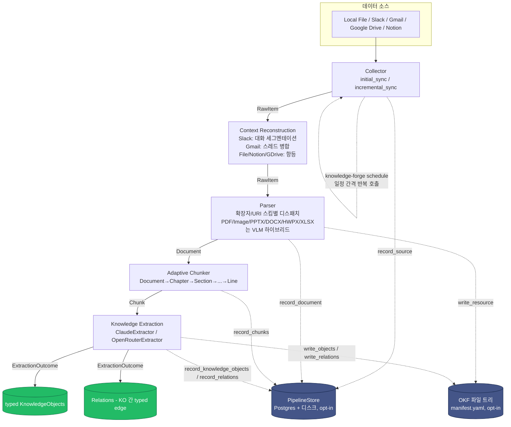
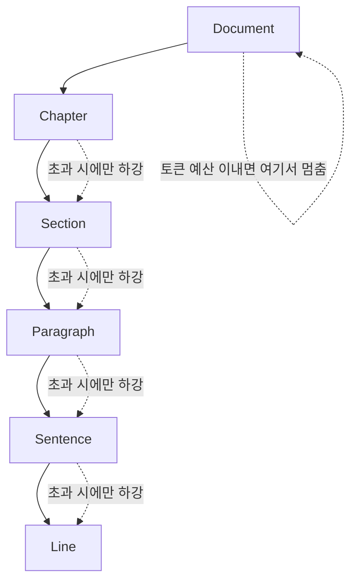
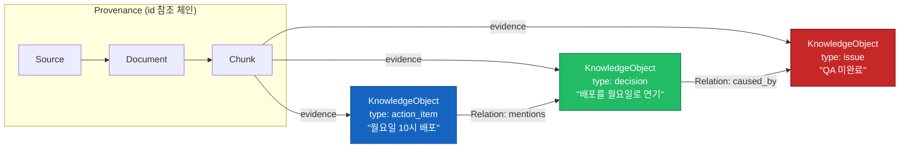
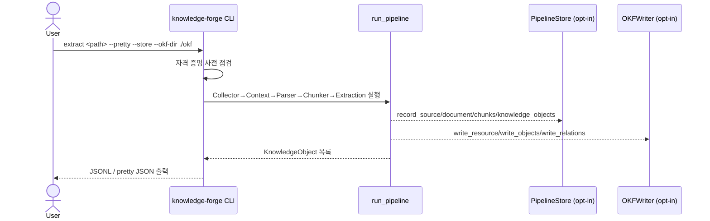

# Knowledge Forge

**Enterprise Knowledge Extraction Pipeline** — Slack/Gmail/Google Drive/Notion 및 PDF/DOCX/XLSX/PPTX/HWPX/Markdown/TXT/Image를 수집해, 문서 구조와 provenance를 보존한 **typed Knowledge Object 그래프**로 변환한다.

```text
Collector → Context Reconstruction → Parser → Adaptive Chunker → Knowledge Extraction → Knowledge Object
```

> 한 줄 정의: Slack, Gmail, Google Drive, Notion 및 다양한 파일을 수집하여 구조와 의미를 보존한 Knowledge Object로 변환하는 Enterprise Knowledge Ingestion & Extraction Pipeline. ([PRD.md](PRD.md))

전체 설계 근거와 상세 문서는 [`wiki/README.md`](wiki/README.md)에 인덱싱되어 있다. 이 README는 전체 그림과 빠른 시작을 위한 진입점이다.

## 목차

- [아키텍처](#아키텍처)
- [파이프라인 단계](#파이프라인-단계)
- [Adaptive Chunking: 최대 Semantic Unit 유지](#adaptive-chunking-최대-semantic-unit-유지)
- [Knowledge Object: typed envelope + graph relation](#knowledge-object-typed-envelope--graph-relation)
- [지원 데이터 소스 · 포맷](#지원-데이터-소스--포맷)
- [빠른 시작](#빠른-시작)
- [환경 변수](#환경-변수)
- [CLI 명령어](#cli-명령어)
- [에이전트로 지식 베이스 검색하기](#에이전트로-지식-베이스-검색하기)
  - [검색 평가](#검색-평가)
- [Docker로 실행하기](#docker로-실행하기)
- [프로젝트 구조](#프로젝트-구조)
- [테스트](#테스트)
  - [DB 테스트](#db-테스트)
- [로드맵과 스코프](#로드맵과-스코프)
- [문서](#문서)

## 아키텍처

각 단계는 독립된 인터페이스(ABC)로 분리되어 있어, 새 소스나 포맷을 추가할 때 다른 단계를 건드릴 필요가 없다 — 자세한 내용은 [`wiki/architecture.md`](wiki/architecture.md) 참고.



점선은 옵션 경로다: `PipelineStore`([`wiki/storage.md`](wiki/storage.md))는 `--store`/`KF_DATABASE_URL`이 설정된 경우에만 동작하며, `OKFWriter`([`wiki/okf.md`](wiki/okf.md))는 데이터베이스 없이도 사람이 읽을 수 있는 파일 기반 Knowledge Base를 만드는 독립적인 옵션이다. 둘 다 없어도 파이프라인은 동일하게 동작한다(출력만 생성).

## 파이프라인 단계

| 단계 | 위치 | 책임 | 문서 |
|---|---|---|---|
| **Collector** | `src/knowledge_forge/collectors/` | 원본 데이터를 `RawItem`(uri/content/content_hash/modified_at/metadata/deleted)으로 통일. Initial/Incremental Sync, 변경·삭제 감지 | [`saas-connectors.md`](wiki/saas-connectors.md) |
| **Context Reconstruction** | `src/knowledge_forge/context/` | RawItem 하나가 항상 독립된 의미 단위는 아니라는 문제 해결 — Slack 대화 세그멘테이션, Gmail 스레드 병합 | [`context-reconstruction.md`](wiki/context-reconstruction.md) |
| **Parser** | `src/knowledge_forge/parsers/` | 모든 포맷을 공통 `Document`(Heading/TextBlock/TableElement/ListElement/ImageElement)로 변환. 표/이미지는 VLM 하이브리드 | [`parsers.md`](wiki/parsers.md), [`vision-extraction.md`](wiki/vision-extraction.md) |
| **Adaptive Chunker** | `src/knowledge_forge/chunking/` | 고정 토큰이 아닌 문서 구조 기반 청킹 — 가능한 가장 큰 Semantic Unit 유지 | [`adaptive-chunking.md`](wiki/adaptive-chunking.md) |
| **Knowledge Extraction** | `src/knowledge_forge/extraction/` | LLM으로 Entity/Relation/Fact/Event/Decision/... 추출, `ExtractionOutcome`(objects + relations) 반환 | [`knowledge-object-schema.md`](wiki/knowledge-object-schema.md), [`llm-providers.md`](wiki/llm-providers.md) |
| **Storage** (선택) | `src/knowledge_forge/storage/` | 원본은 디스크, 구조화 레코드는 PostgreSQL | [`storage.md`](wiki/storage.md) |
| **OKF** (선택) | `src/knowledge_forge/okf/` | manifest.yaml + 파일 트리로 된 git-diff 가능한 Knowledge Base | [`okf.md`](wiki/okf.md) |
| **Scheduling** (선택) | `src/knowledge_forge/scheduling/` | `APScheduler` 기반 주기 실행 | [`scheduling.md`](wiki/scheduling.md) |

### 확장 포인트

- **새 SaaS 커넥터**: `collectors/saas/`에 `SaaSCollector` 상속 클래스 추가 → 끝. Parser/Chunker/Extraction은 수정 불필요.
- **새 파일 포맷**: `parsers/`에 `Parser` 상속 클래스 추가 후 `registry.py`에 등록 → 끝.

## Adaptive Chunking: 최대 Semantic Unit 유지

고정 토큰 단위로 자르지 않고, 상위 구조 단위가 컨텍스트 윈도우를 초과할 때만 하위 단위로 내려간다.



## Knowledge Object: typed envelope + graph relation

청크 하나가 항상 하나의 Knowledge Object로 고정 대응되지 않는다 — 예를 들어 Slack 대화 한 덩어리가 `Issue`, `Decision`, `ActionItem` 세 개의 독립적인 객체와 그 사이의 `caused_by` 관계를 만들 수 있다. 그래서 `Extractor.extract()`는 `KnowledgeObject` 하나가 아니라 `ExtractionOutcome`(`objects: list[KnowledgeObject]`, `relations: list[Relation]`)을 반환한다.



`KnowledgeObject`의 `type`(`entity`/`fact`/`event`/`decision`/`action_item`/`requirement`/`policy`/`issue`/`concept`)이 타입을 구분하고, 타입별 payload는 고정 스키마가 아닌 `content: dict`에 담는다 — 새 타입을 추가해도 모델 자체를 바꿀 필요가 없다. `source`/`document`는 전체 레코드가 아니라 가벼운 `SourceRef`/`DocumentRef` 참조만 담아 중복 저장을 피한다. 전체 필드 스펙과 예시 JSON은 [`wiki/knowledge-object-schema.md`](wiki/knowledge-object-schema.md) 참고.

## 지원 데이터 소스 · 포맷

### SaaS 커넥터

실제 SDK 연동으로 전부 구현되어 있다 (`src/knowledge_forge/collectors/saas/`). `collectors/saas/factory.py`의 `build_*_collector()`가 `KF_`-접두사 `.env` 값(아래 [환경 변수](#환경-변수) 참고)을 읽어 인증된 SDK 클라이언트 생성부터 커넥터 조립까지 대신해준다 — 직접 SDK 클라이언트를 만들어 주입할 필요가 없다. `knowledge-forge extract`/`schedule`의 `--source {slack,notion,gdrive,gmail}`로 바로 실행할 수 있다 (자세한 방법: [`wiki/dev-guide.md`](wiki/dev-guide.md#saas-커넥터-사용하기)).

| 소스 | 초기 동기화 | 증분 동기화 | 삭제 감지 |
|---|---|---|---|
| Slack | `conversations_history` 페이지네이션 | `conversations_history(oldest=...)` | ❌ (API 한계) |
| Gmail | `messages().list`+`.get()` | History API | ✅ |
| Google Drive | `files().list` + `get_media` | Changes API | ✅ |
| Notion | `search()` + 재귀 `blocks.children.list()` | 위와 동일 + `last_edited_time` 필터 | ❌ → 매니페스트 diff |

### 파일 포맷

| 포맷 | 확장자 | 텍스트 추출 | 표/이미지 |
|---|---|---|---|
| PDF | `.pdf` | 규칙 기반 (`pdfplumber`) | **VLM 하이브리드** |
| DOCX | `.docx` | 규칙 기반 (`python-docx`) | 표: 규칙 기반 · 이미지: VLM |
| PPTX | `.pptx` | 규칙 기반 (`python-pptx`) | 표/차트: 규칙 기반 · 그림: VLM |
| HWPX | `.hwpx` | 규칙 기반 (`python-hwpx`) | 표: 규칙 기반 · 이미지: VLM |
| XLSX | `.xlsx` | — | 표: 규칙 기반 (`openpyxl`) · 시트에 앵커된 이미지: VLM |
| Markdown | `.md` | 규칙 기반 (`markdown-it-py`, GFM 표 포함) | 규칙 기반 |
| TXT | `.txt` | 규칙 기반 | — |
| Image | `.png`/`.jpg`/`.jpeg` | — | **VLM 전용** |

"VLM 하이브리드/전용" 항목은 실패 시에만 쓰는 폴백이 아니라, 표/이미지/차트를 항상 Claude vision으로 처리하는 명시적 정책이다 — 근거는 [`wiki/vision-extraction.md`](wiki/vision-extraction.md). 포맷별 라이브러리/라이선스 근거(예: PDF에 `pdfplumber`(MIT)를 쓰고 `PyMuPDF`(AGPL)를 피한 이유)는 [`wiki/parsers.md`](wiki/parsers.md).

## 빠른 시작

의존성 관리는 [`uv`](https://docs.astral.sh/uv/)를 사용한다.

```bash
uv sync
uv run knowledge-forge extract path/to/file.md --pretty
```

Anthropic 자격 증명이 필요하다 — `ANTHROPIC_API_KEY`, `ANTHROPIC_AUTH_TOKEN`, 또는 `ant auth login`으로 저장된 OAuth 프로필 중 SDK가 자동으로 찾을 수 있는 하나면 된다.

포맷/커넥터별 선택적 의존성이 필요하면 추가한다:

```bash
uv sync --extra xlsx --extra pptx --extra hwpx --extra slack --extra google --extra notion --extra dev
```

## 환경 변수

`KF_` 접두사를 가진 값은 `src/knowledge_forge/config.py`의 `Settings`에서 관리되며, 저장소 루트의 `.env` 파일(`env_file=".env"`)을 자동으로 읽는다 — 템플릿은 [`.env.example`](.env.example) 참고.

| 환경변수 | 기본값 | 설명 |
|---|---|---|
| `KF_EXTRACTION_MODEL` | `claude-opus-5` | Knowledge Extraction 모델 (`--model`로도 override) |
| `KF_MAX_TOKENS_PER_CHUNK` | `4000` | 청크당 최대 토큰 예산 (`--max-tokens`로도 override) |
| `KF_MIN_TOKENS_PER_CHUNK` | `50` | 이 값 미만인 리프 청크는 인접 형제 청크와 병합을 시도한다(Chapter/Section 경계는 절대 넘지 않고, 표 청크는 다른 어떤 청크와도 병합하지 않는다) |
| `KF_MAX_CONCURRENT_LLM_REQUESTS` | `5` | Extractor/VisionExtractor 인스턴스당 동시 LLM 요청 수 상한 |
| `KF_EXTRACTION_GROUP_MAX_TOKENS` | `4000` | 한 문서 안에서 인접한 청크를 Knowledge Extraction 호출 1회로 묶을 때의 누적 토큰 예산(개수 기준 아님) — 큰 청크는 혼자, 작은 청크는 여럿이 한 호출로 묶인다 |
| `KF_DATABASE_URL` | (없음) | PostgreSQL DSN — 없으면 저장 없이 출력만 생성 |
| `KF_DATA_DIR` | `./data` | 원본 바이트를 저장하는 디스크 blob 스토어 루트 |
| `KF_LLM_PROVIDER` | `anthropic` | `anthropic` \| `openrouter` \| `claude_agent_sdk` — Extraction/Vision 백엔드 선택(`claude_agent_sdk`는 API 키 없이 로컬 `claude` 로그인 사용) |
| `KF_OPENROUTER_EXTRACTION_MODEL` | `anthropic/claude-haiku-4.5` | OpenRouter 사용 시 Extraction 모델 슬러그 |
| `KF_OPENROUTER_VISION_MODEL` | `anthropic/claude-haiku-4.5` | OpenRouter 사용 시 Vision 모델 슬러그 |
| `KF_CLAUDE_AGENT_SDK_VISION_MODEL` | `claude-haiku-4-5-20251001` | `claude_agent_sdk` 사용 시 Vision 모델 |
| `KF_OPENROUTER_BASE_URL` | `https://openrouter.ai/api/v1` | OpenRouter API 엔드포인트 |
| `OPENROUTER_API_KEY` | (없음) | OpenRouter API 키 |
| `ANTHROPIC_API_KEY` / `ANTHROPIC_AUTH_TOKEN` | (없음) | Anthropic 자격 증명 (SDK가 자동 탐색) |
| `KF_OKF_DIR` | (없음) | `agent`/`/ui`/`GET /okf/*`가 읽는 OKF 파일 트리 루트 — `extract --okf-dir`로 함께 기록 |
| `KF_EMBEDDING_ENABLED` | `false` | `extract`/`schedule`이 KnowledgeObject를 pgvector에 임베딩할지 (opt-in, `--embed`로도 override) |
| `KF_EMBEDDING_MODEL` | `text-embedding-3-small` | 임베딩 모델 — `vector_search`도 같은 기본값을 검색 대상 모델로 쓴다 |
| `OPENAI_API_KEY` | (없음) | 임베딩 API 키 (`KF_`-접두사 아님, 프로바이더가 직접 읽음) |
| `KF_AGENT_PROVIDER` | `anthropic` | `anthropic` \| `openai_compatible` — `knowledge-forge agent`의 백엔드 (`llm_provider`와 별도 키) |
| `KF_AGENT_MODEL` | `claude-sonnet-5` | `knowledge-forge agent`가 쓰는 모델 |
| `KF_AGENT_TOOL_SURFACE` | `minimal` | `minimal` \| `full` — 에이전트에게 노출할 검색 도구 범위 (아래 `agent` 절 참고) |
| `KF_AGENT_FILE_SEARCH_ENABLED` | `false` | `file_search`(OKF 파일 트리 검색)를 에이전트 도구에 넣을지 — 기본은 넣지 않는다. Postgres 없는 OKF 전용 배포에서는 켜야 한다 (아래 `agent` 절 참고) |

임베딩/에이전트 관련 전체 환경변수는 [`wiki/embeddings.md`](wiki/embeddings.md), [`wiki/agent-runtime.md`](wiki/agent-runtime.md) 참고.

### SaaS 커넥터 자격 증명

`collectors/saas/factory.py`의 `build_*_collector()`가 읽는 값 — 쓰려는 소스만 채우면 된다.

| 환경변수 | 설명 |
|---|---|
| `KF_SLACK_BOT_TOKEN` | Slack Bot Token (`xoxb-...`) |
| `KF_SLACK_CHANNELS` | 동기화할 채널 ID, 콤마 구분 (예: `C0123,C0456`) |
| `KF_NOTION_TOKEN` | Notion Integration 토큰 |
| `KF_NOTION_DATABASE_ID` | 특정 데이터베이스로 범위를 좁힐 때만 설정 (없으면 접근 가능한 모든 페이지 검색) |
| `KF_GDRIVE_CREDENTIALS_JSON` | 서비스 계정 JSON — 인라인 값 또는 파일 경로 둘 다 허용 |
| `KF_GDRIVE_FOLDER_ID` | 동기화 대상 폴더 (없으면 서비스 계정이 볼 수 있는 전체 파일) |
| `KF_GMAIL_CREDENTIALS_PATH` | OAuth 클라이언트 설정 파일 경로(토큰 최초 발급용) |
| `KF_GMAIL_TOKEN_PATH` | 이미 발급된 user OAuth 토큰(`token.json`) 경로 — 필수, 이 파일이 있어야 factory가 클라이언트를 만든다 |
| `KF_GMAIL_QUERY` | Gmail 검색 쿼리로 동기화 범위 제한 (예: `label:PI/CANDIDATE`) |

전체 설명과 프로바이더 전환 근거는 [`wiki/dev-guide.md`](wiki/dev-guide.md), [`wiki/llm-providers.md`](wiki/llm-providers.md) 참고.

## CLI 명령어



### 1회성 추출

```bash
uv run knowledge-forge extract <path> [--max-tokens 4000] [--model claude-opus-5] \
  [--output out.jsonl] [--pretty] [--store/--no-store] [--okf-dir ./okf]
```

- `<path>`: 단일 파일 또는 디렉토리(재귀 순회).
- `--output` 생략 시 stdout에 JSONL(한 줄에 KnowledgeObject 하나) 출력, `--pretty`는 들여쓴 JSON 배열.
- `--store`(기본값): `KF_DATABASE_URL`이 있으면 Postgres+디스크에 저장. 저장된 content_hash와 같고 문서가 이미 있는 파일은 파싱·추출·임베딩을 건너뛴다(강제로 다시 처리하려면 `reparse`).
- `--okf-dir`: 파일 기반 Knowledge Base(`manifest.yaml` + `resources/`/`objects/`/`relations/`)도 함께 기록.

### 주기 실행

```bash
uv run knowledge-forge schedule <path> --interval-seconds 600
```

### DB 스키마 초기화

```bash
uv run knowledge-forge db init
```

### API 서버 + Job Queue/Worker (Ingest/Process 분리)

```bash
uv run knowledge-forge serve [--host 0.0.0.0] [--port 8000]   # POST /ingest → 즉시 202+job_id
uv run knowledge-forge worker [--concurrency 4]                # Celery 워커 - jobs를 실제로 실행
uv run --extra flower celery -A knowledge_forge.celery_app flower   # 모니터링 GUI, http://localhost:5555
```

`serve`는 LLM을 호출하지 않아 Anthropic 자격증명이 필요 없고(`--store` 없이도 `KF_DATABASE_URL`은
필수), `worker`는 `extract`/`schedule`과 동일하게 필요하다. 둘 다 `KF_REDIS_URL`(기본
`redis://localhost:6379/0`)로 Celery 브로커를 가리킨다. 자세한 내용, 엔드포인트 목록,
job 상태 전이는 [`wiki/api.md`](wiki/api.md) 참고.

### 브라우저에서 OKF 트리 보기 (`/ui`)

`serve`가 뜬 상태에서 `KF_OKF_DIR`만 지정하면 Postgres/Redis 없이도 `/ui`에서 OKF 파일
트리를 훑어볼 수 있다 — 프로젝트 선택 → 타입별 카드/검색 → 파일 상세(frontmatter +
렌더링된 body) → 그래프, ⌘K로 프로젝트 전역 검색까지. Tailwind+shadcn/ui 기반의
Obsidian풍 다크 우선 UI([`wiki/ui.md`](wiki/ui.md))로, `frontend/`의 React+Vite 앱을
한 번 빌드해 둬야 한다:

```bash
npm --prefix frontend install
npm --prefix frontend run build       # frontend/dist 생성 (1회, 이후 코드 바뀔 때만 재실행)

KF_OKF_DIR=./okf uv run knowledge-forge serve --port 8000
# http://localhost:8000/ui/ 접속
```

프론트엔드 자체를 고칠 때는 핫리로드가 붙는 `npm --prefix frontend run dev`(`:5173`, `/okf/*`를
8000번 포트로 프록시)를 쓴다. 자세한 내용은 [`wiki/okf.md`](wiki/okf.md#브라우저로-확인하기-get-ui),
아키텍처/디자인 근거는 [`wiki/ui.md`](wiki/ui.md) 참고.

## 에이전트로 지식 베이스 검색하기

`knowledge-forge agent`는 쌓인 Knowledge Base(OKF 파일 트리 + pgvector 임베딩)를 도구 호출
루프로 검색/편집하는 모델 벤더 중립 에이전트다(Anthropic 네이티브 또는 OpenAI-호환/OpenRouter).

```bash
KF_OKF_DIR=./okf uv run knowledge-forge agent "인증 방식을 OAuth로 바꾸기로 한 결정이 있었나?"
KF_OKF_DIR=./okf uv run knowledge-forge agent --interactive   # REPL, Ctrl-D로 종료
```

기본으로 노출되는 도구(`KF_AGENT_TOOL_SURFACE=minimal`):

| 도구 | 조건 | 역할 |
|---|---|---|
| `search` | `KF_DATABASE_URL` | **통합 검색.** 질의 의도를 분석해 제목 조회/렉시컬/벡터/메타데이터 필터/멀티홉/문서 전체 읽기를 결정론적으로 조합한다 — 어떤 검색을 어떤 순서로 돌릴지는 모델이 아니라 `search/retrieve.py`가 정한다. 질문을 자연어 그대로 넘기면 시간 표현·파일명·에러 코드까지 알아서 읽는다 |
| `read_document` | `KF_DATABASE_URL` | 검색으로 특정한 문서 하나의 청크 전체를 순서대로 읽는다 — 전체 요약/부재 확인("언급되지 않은 것")/순서 비교처럼 top-k로는 답할 수 없는 질문용 |
| `sql_search` | `KF_DATABASE_URL` | Knowledge Base를 PostgreSQL SQL로 직접 조회(Text-to-SQL) — 집계(COUNT/GROUP BY), 여러 조건의 AND/OR, 특정 사람/속성이 언급된 항목처럼 `search`가 다루지 못하는 구조화 질의용. 읽기 전용만 허용 |
| `file_search` | `KF_AGENT_FILE_SEARCH_ENABLED=true` **且** `KF_DATABASE_URL`이 없을 때 (+ `KF_OKF_DIR`) | OKF 파일 트리를 키워드/frontmatter로 검색. **기본으로는 꺼져 있다** — Postgres 코퍼스와 어긋날 수 있고, `KF_OKF_DIR`이 없으면 에러 대신 조용히 빈 결과를 돌려준다. Postgres 없는 OKF 전용 배포에서는 유일한 검색 경로이므로 켤 것 |
| `read_file` / `write_file` / `edit_file` / `list_dir` | `KF_OKF_DIR` | OKF 루트 트리 범위로 제한된 파일 읽기/쓰기 |
| `write_memory` | 항상 | 세션이 끝나도 남을 사실/결정을 프로젝트별 기억 파일에 기록 |
| `delegate_task` | 항상 | 독립적인 하위 조사를 새 대화의 서브에이전트에게 위임 |

`KF_AGENT_TOOL_SURFACE=full`로 두면 개별 검색 도구(`vector_search`/`document_search`/
`lexical_search`/`plan_search`)까지 전부 노출된다 — `search`가 놓친 질의를 손으로 파고들 때용이다
(`file_search`는 표면과 별개로 `KF_AGENT_FILE_SEARCH_ENABLED`가 정한다).
표와 이유는 [`wiki/agent-runtime.md`](wiki/agent-runtime.md)의 "도구 표면" 절 참고.

`vector_search`를 쓰려면 먼저 KnowledgeObject를 임베딩해 둬야 한다:

```bash
uv run knowledge-forge extract <path> --store --embed   # 추출과 동시에 임베딩
uv run knowledge-forge embed                              # 이미 저장된 KO를 소급 임베딩(백필)
```

넓은 엔터프라이즈 RAG 아키텍처(Query Understanding, Hybrid rerank, Context Engineering,
Map-Reduce, Temporal Search, Evidence Grounding, Feedback Loop) 관점에서 지금 무엇이 구현되어
있고 무엇이 설계만 있는지는 [`wiki/search-architecture.md`](wiki/search-architecture.md) 참고.

전체 도구 계약, 시스템 프롬프트, 컨텍스트 압축 등 harness 설계는 [`wiki/agent-runtime.md`](wiki/agent-runtime.md), 임베딩 파이프라인은 [`wiki/embeddings.md`](wiki/embeddings.md) 참고.

### 검색 평가

골든셋을 자동으로 만들고 그 골든셋으로 검색 품질을 잰다. 골든셋은 생성할 때 기준 단위(`chunk` 또는 `knowledge_object`)를 정하고, 평가는 그 단위로만 검색하고 채점한다. 기본은 LLM 호출 없는 retrieval 지표이고, 에이전트 답변까지 채점하려면 `--e2e`를 켠다.

```bash
export OPENROUTER_API_KEY=...   # .env의 비-KF_ 키는 자동으로 읽히지 않는다
uv run knowledge-forge embed --embedding-source knowledge_object      # KO 골든셋을 쓸 때만, 최초 1회
uv run knowledge-forge eval gen --grain chunk --n 300                 # tests/eval/golden/에 골든셋 JSON
uv run knowledge-forge eval run --golden tests/eval/golden/<version>.json --split dev
uv run knowledge-forge eval run --golden tests/eval/golden/<version>.json --e2e
uv run knowledge-forge eval compare out/eval/<A>.json out/eval/<B>.json
```

결과는 `out/eval/<run_id>.json`에 남는다. 게이트·지표 정의·한계는 [`wiki/evaluation.md`](wiki/evaluation.md) 참고.

## Docker로 실행하기

```bash
export ANTHROPIC_API_KEY=sk-ant-...
docker compose up -d postgres     # 로컬 Postgres (호스트 15432 포트)
docker compose run --rm app db init
docker compose run --rm app extract /app/input/sample.md --pretty
docker compose run --rm app schedule /app/input --interval-seconds 600

# API 서버 + 워커 + 모니터링 GUI (wiki/api.md) - 별도 service로 떠 있음
docker compose up -d redis api worker flower   # Flower: http://localhost:5555
```

수집할 파일은 `./input`에 두면 컨테이너의 `/app/input`에 읽기 전용으로 마운트되고, 원본 blob 스토어는 `./data`에 영속화된다. 자세한 내용은 [`wiki/dev-guide.md`](wiki/dev-guide.md), [`wiki/storage.md`](wiki/storage.md) 참고.

## 프로젝트 구조

```text
src/knowledge_forge/
├── cli.py               # Typer 기반 CLI (extract / schedule / serve / worker / db init)
├── config.py             # KF_* 환경변수 (Settings)
├── pipeline.py           # run_pipeline() — 전 단계 오케스트레이션
├── ingest.py              # run_local_ingest() — worker가 쓰는 파이프라인 호출 헬퍼
├── worker.py              # Job queue worker (jobs 테이블 폴링, wiki/api.md)
├── api/                   # FastAPI 서버 — POST /ingest, GET /jobs, GET /knowledge-objects 등
├── collectors/           # Collector ABC + LocalFileCollector + saas/ (Slack/Gmail/GDrive/Notion)
├── context/              # ContextReconstructor ABC (Slack 세그멘테이션, Gmail 스레드 병합)
├── parsers/               # Parser ABC + 포맷별 구현 + ParserRegistry
├── chunking/             # AdaptiveChunker — Document→Chapter→...→Line
├── extraction/            # Extractor ABC + ClaudeExtractor/OpenRouterExtractor + outcome.py
├── vision/                # VisionExtractor — 표/이미지 VLM 추출 (Anthropic/OpenRouter)
├── models/                # Pydantic 모델: Source/Document/Chunk/KnowledgeObject/Relation
├── storage/               # PipelineStore (Postgres + 디스크, opt-in) + JobStore (jobs 큐)
├── okf/                   # OKFWriter — 파일 기반 Knowledge Base (opt-in)
├── embedding/             # EmbeddingProvider ABC + OpenAIEmbeddingProvider (pgvector 임베딩, opt-in)
├── search/                # file_search/vector_search/sql_search + planner/router/rerank/temporal — agent 도구가 감싸는 검색 서비스 함수
├── agent/                 # 모델 벤더 중립 Agent Runtime — knowledge-forge agent (wiki/agent-runtime.md)
└── scheduling/             # APScheduler 기반 주기 실행

tests/                     # pytest, asyncio_mode=auto — 모델/파서/청커는 네트워크 불필요,
                            # Extraction은 anthropic.AsyncAnthropic 모킹으로 API 키 없이 통과
frontend/                   # React+Vite OKF 뷰어 — 빌드하면 api/app.py가 /ui에 마운트 (wiki/ui.md)
wiki/                       # 아키텍처/스키마/설계 결정 전체 문서 인덱스
PRD.md                      # 제품 요구사항
```

## 테스트

```bash
uv run pytest
```

`tests/test_pipeline_e2e.py`가 LLM을 모킹한 상태로 Collector→Parser→Chunker→Extraction 전체를 실행해 provenance 체인까지 검증하는 스모크 테스트다. 자세한 내용은 [`wiki/dev-guide.md`](wiki/dev-guide.md#테스트) 참고.

### DB 테스트

위 명령은 `789 passed, 89 skipped`로 끝난다. 건너뛴 89개는 실제 Postgres가 있어야 도는 테스트(`tests/storage/`, `tests/search/test_retrieve.py`, `tests/test_worker.py` 등)이고, `storage/postgres_store.py`의 pgvector/pg_trgm 검색 SQL을 검증하는 것도 여기 있다. `docker compose up -d postgres redis`로 인프라를 띄운 뒤 DSN을 주면 전부 돈다(redis는 DB 테스트가 아니라 `tests/api/test_api.py`가 Celery `apply_async`를 타면서 필요로 한다):

```bash
KF_TEST_DATABASE_URL=postgresql://kf:kf@localhost:15432/knowledge_forge uv run pytest -q
# 878 passed
```

공용 코퍼스가 담긴 `knowledge_forge` 대신 빈 DB를 쓰고 싶으면 아무 데이터베이스나 새로 만들어 가리키면 된다 — 스키마와 확장은 `init_schema()`가 알아서 만든다(단 `pgvector/pgvector:pg16`처럼 pgvector가 실린 이미지여야 한다).

`KF_REQUIRE_DB_TESTS=1`을 함께 주면 이 89개가 skip되는 순간 run이 실패한다. DSN을 빠뜨린 채 초록불을 보는 사고를 막는 스위치이고, CI가 항상 켜 둔다.

CI(`.github/workflows/ci.yml`)는 push/PR마다 `docker-compose.yml`과 같은 pgvector Postgres·Redis 서비스를 띄워 Python 3.10과 3.13에서 `ruff check` → `mypy` → `pytest`를 돌린다. 즉 DB 테스트는 로컬에서 깜빡해도 CI에서는 반드시 실행된다.

## 로드맵과 스코프

Phase 1~5(전체 파이프라인 스캐폴딩, 8개 파일 포맷 + 4개 SaaS 커넥터 실구현, Context Reconstruction, Storage/OKF/Scheduling, 비동기 전환, typed envelope + graph relation 모델 재설계)까지 완료되었다. Vector DB / Graph DB / Ontology-OWL / Search-RAG / Agent / Dashboard / Chat UI는 PRD가 명시한 MVP 제외 범위지만, 현재 설계(typed `KnowledgeObject` + id 기반 `Relation` 그래프)가 이들을 나중에 막지 않는다 — 근거는 [`wiki/roadmap.md`](wiki/roadmap.md)에 항목별로 정리되어 있다.

## 문서

전체 문서 인덱스는 [`wiki/README.md`](wiki/README.md). 핵심만 보려면 [`wiki/architecture.md`](wiki/architecture.md) → [`wiki/knowledge-object-schema.md`](wiki/knowledge-object-schema.md) → [`wiki/roadmap.md`](wiki/roadmap.md) 순으로 읽는 걸 권장한다.
