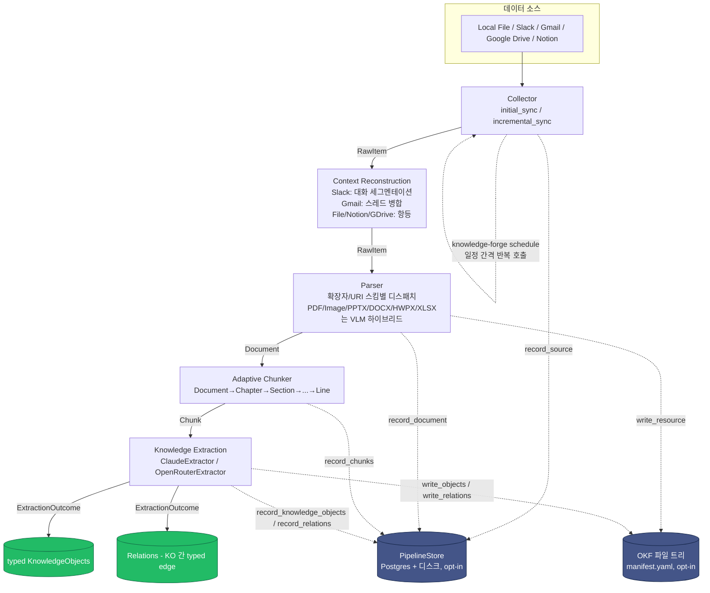
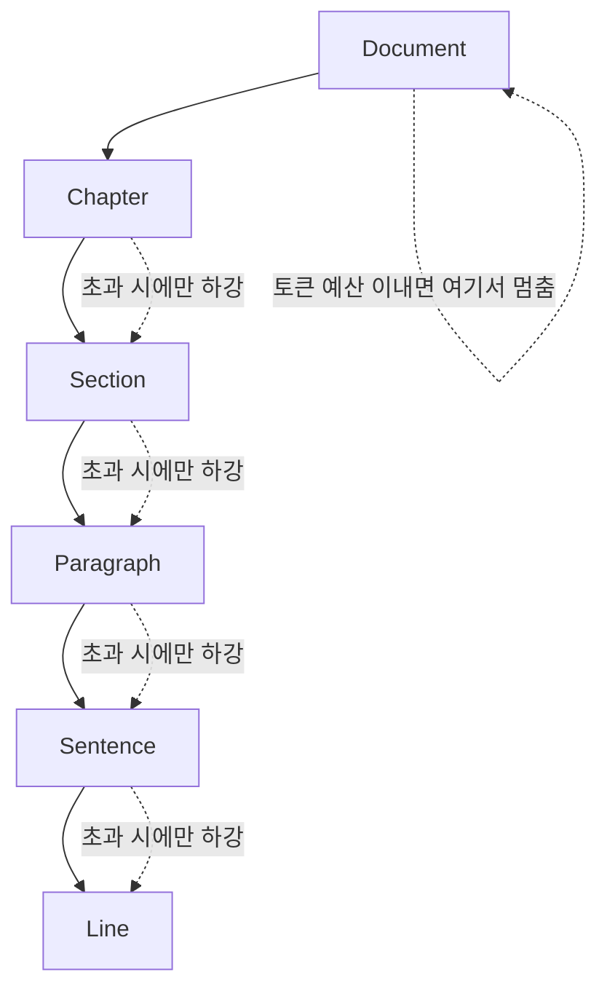
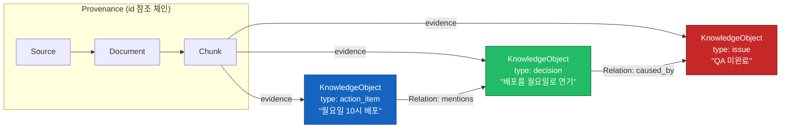
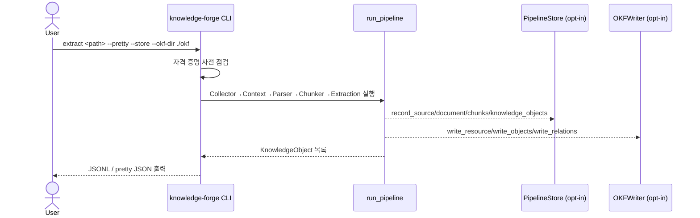

# Knowledge Forge

**Enterprise Knowledge Extraction Pipeline** — Slack/Gmail/Google Drive/Notion 및 PDF/DOCX/XLSX/PPTX/HWPX/Markdown/TXT/Image를 수집해, 문서 구조와 provenance를 보존한 **typed Knowledge Object 그래프**로 변환한다.

```text
Collector → Context Reconstruction → Parser → Adaptive Chunker → Knowledge Extraction → Knowledge Object
```

> 한 줄 정의: Slack, Gmail, Google Drive, Notion 및 다양한 파일을 수집하여 구조와 의미를 보존한 Knowledge Object로 변환하는 Enterprise Knowledge Ingestion & Extraction Pipeline. ([PRD.md](PRD.md))

전체 설계 근거와 상세 문서는 [`wiki/README.md`](wiki/README.md)에 인덱싱되어 있다. 이 README는 전체 그림과 빠른 시작을 위한 진입점이다.

## 목차

- [아키텍처](#아키텍처)
- [파이프라인 단계](#파이프라인-단계)
- [Adaptive Chunking: 최대 Semantic Unit 유지](#adaptive-chunking-최대-semantic-unit-유지)
- [Knowledge Object: typed envelope + graph relation](#knowledge-object-typed-envelope--graph-relation)
- [지원 데이터 소스 · 포맷](#지원-데이터-소스--포맷)
- [빠른 시작](#빠른-시작)
- [환경 변수](#환경-변수)
- [CLI 명령어](#cli-명령어)
- [Docker로 실행하기](#docker로-실행하기)
- [프로젝트 구조](#프로젝트-구조)
- [테스트](#테스트)
- [로드맵과 스코프](#로드맵과-스코프)
- [문서](#문서)

## 아키텍처

각 단계는 독립된 인터페이스(ABC)로 분리되어 있어, 새 소스나 포맷을 추가할 때 다른 단계를 건드릴 필요가 없다 — 자세한 내용은 [`wiki/architecture.md`](wiki/architecture.md) 참고.



점선은 옵션 경로다: `PipelineStore`([`wiki/storage.md`](wiki/storage.md))는 `--store`/`KF_DATABASE_URL`이 설정된 경우에만 동작하며, `OKFWriter`([`wiki/okf.md`](wiki/okf.md))는 데이터베이스 없이도 사람이 읽을 수 있는 파일 기반 Knowledge Base를 만드는 독립적인 옵션이다. 둘 다 없어도 파이프라인은 동일하게 동작한다(출력만 생성).

## 파이프라인 단계

| 단계 | 위치 | 책임 | 문서 |
|---|---|---|---|
| **Collector** | `src/knowledge_forge/collectors/` | 원본 데이터를 `RawItem`(uri/content/content_hash/modified_at/metadata/deleted)으로 통일. Initial/Incremental Sync, 변경·삭제 감지 | [`saas-connectors.md`](wiki/saas-connectors.md) |
| **Context Reconstruction** | `src/knowledge_forge/context/` | RawItem 하나가 항상 독립된 의미 단위는 아니라는 문제 해결 — Slack 대화 세그멘테이션, Gmail 스레드 병합 | [`context-reconstruction.md`](wiki/context-reconstruction.md) |
| **Parser** | `src/knowledge_forge/parsers/` | 모든 포맷을 공통 `Document`(Heading/TextBlock/TableElement/ListElement/ImageElement)로 변환. 표/이미지는 VLM 하이브리드 | [`parsers.md`](wiki/parsers.md), [`vision-extraction.md`](wiki/vision-extraction.md) |
| **Adaptive Chunker** | `src/knowledge_forge/chunking/` | 고정 토큰이 아닌 문서 구조 기반 청킹 — 가능한 가장 큰 Semantic Unit 유지 | [`adaptive-chunking.md`](wiki/adaptive-chunking.md) |
| **Knowledge Extraction** | `src/knowledge_forge/extraction/` | LLM으로 Entity/Relation/Fact/Event/Decision/... 추출, `ExtractionOutcome`(objects + relations) 반환 | [`knowledge-object-schema.md`](wiki/knowledge-object-schema.md), [`llm-providers.md`](wiki/llm-providers.md) |
| **Storage** (선택) | `src/knowledge_forge/storage/` | 원본은 디스크, 구조화 레코드는 PostgreSQL | [`storage.md`](wiki/storage.md) |
| **OKF** (선택) | `src/knowledge_forge/okf/` | manifest.yaml + 파일 트리로 된 git-diff 가능한 Knowledge Base | [`okf.md`](wiki/okf.md) |
| **Scheduling** (선택) | `src/knowledge_forge/scheduling/` | `APScheduler` 기반 주기 실행 | [`scheduling.md`](wiki/scheduling.md) |

### 확장 포인트

- **새 SaaS 커넥터**: `collectors/saas/`에 `SaaSCollector` 상속 클래스 추가 → 끝. Parser/Chunker/Extraction은 수정 불필요.
- **새 파일 포맷**: `parsers/`에 `Parser` 상속 클래스 추가 후 `registry.py`에 등록 → 끝.

## Adaptive Chunking: 최대 Semantic Unit 유지

고정 토큰 단위로 자르지 않고, 상위 구조 단위가 컨텍스트 윈도우를 초과할 때만 하위 단위로 내려간다.



## Knowledge Object: typed envelope + graph relation

청크 하나가 항상 하나의 Knowledge Object로 고정 대응되지 않는다 — 예를 들어 Slack 대화 한 덩어리가 `Issue`, `Decision`, `ActionItem` 세 개의 독립적인 객체와 그 사이의 `caused_by` 관계를 만들 수 있다. 그래서 `Extractor.extract()`는 `KnowledgeObject` 하나가 아니라 `ExtractionOutcome`(`objects: list[KnowledgeObject]`, `relations: list[Relation]`)을 반환한다.



`KnowledgeObject`의 `type`(`entity`/`fact`/`event`/`decision`/`action_item`/`requirement`/`policy`/`issue`/`concept`)이 타입을 구분하고, 타입별 payload는 고정 스키마가 아닌 `content: dict`에 담는다 — 새 타입을 추가해도 모델 자체를 바꿀 필요가 없다. `source`/`document`는 전체 레코드가 아니라 가벼운 `SourceRef`/`DocumentRef` 참조만 담아 중복 저장을 피한다. 전체 필드 스펙과 예시 JSON은 [`wiki/knowledge-object-schema.md`](wiki/knowledge-object-schema.md) 참고.

## 지원 데이터 소스 · 포맷

### SaaS 커넥터

실제 SDK 연동으로 전부 구현되어 있다 (`src/knowledge_forge/collectors/saas/`). **다만 `knowledge-forge` CLI에는 아직 연결되어 있지 않다** — `extract`/`schedule`은 현재 `LocalFileCollector`만 사용한다. CLI 연동 전까지는 직접 인증된 SDK 클라이언트를 주입해서 사용해야 한다 (자세한 방법: [`wiki/dev-guide.md`](wiki/dev-guide.md#saas-커넥터-사용하기-cli-연동-전)).

| 소스 | 초기 동기화 | 증분 동기화 | 삭제 감지 |
|---|---|---|---|
| Slack | `conversations_history` 페이지네이션 | `conversations_history(oldest=...)` | ❌ (API 한계) |
| Gmail | `messages().list`+`.get()` | History API | ✅ |
| Google Drive | `files().list` + `get_media` | Changes API | ✅ |
| Notion | `search()` + 재귀 `blocks.children.list()` | 위와 동일 + `last_edited_time` 필터 | ❌ → 매니페스트 diff |

### 파일 포맷

| 포맷 | 확장자 | 텍스트 추출 | 표/이미지 |
|---|---|---|---|
| PDF | `.pdf` | 규칙 기반 (`pdfplumber`) | **VLM 하이브리드** |
| DOCX | `.docx` | 규칙 기반 (`python-docx`) | 표: 규칙 기반 · 이미지: VLM |
| PPTX | `.pptx` | 규칙 기반 (`python-pptx`) | 표/차트: 규칙 기반 · 그림: VLM |
| HWPX | `.hwpx` | 규칙 기반 (`python-hwpx`) | 표: 규칙 기반 · 이미지: VLM |
| XLSX | `.xlsx` | — | 표: 규칙 기반 (`openpyxl`) · 시트에 앵커된 이미지: VLM |
| Markdown | `.md` | 규칙 기반 (`markdown-it-py`, GFM 표 포함) | 규칙 기반 |
| TXT | `.txt` | 규칙 기반 | — |
| Image | `.png`/`.jpg`/`.jpeg` | — | **VLM 전용** |

"VLM 하이브리드/전용" 항목은 실패 시에만 쓰는 폴백이 아니라, 표/이미지/차트를 항상 Claude vision으로 처리하는 명시적 정책이다 — 근거는 [`wiki/vision-extraction.md`](wiki/vision-extraction.md). 포맷별 라이브러리/라이선스 근거(예: PDF에 `pdfplumber`(MIT)를 쓰고 `PyMuPDF`(AGPL)를 피한 이유)는 [`wiki/parsers.md`](wiki/parsers.md).

## 빠른 시작

의존성 관리는 [`uv`](https://docs.astral.sh/uv/)를 사용한다.

```bash
uv sync
uv run knowledge-forge extract path/to/file.md --pretty
```

Anthropic 자격 증명이 필요하다 — `ANTHROPIC_API_KEY`, `ANTHROPIC_AUTH_TOKEN`, 또는 `ant auth login`으로 저장된 OAuth 프로필 중 SDK가 자동으로 찾을 수 있는 하나면 된다.

포맷/커넥터별 선택적 의존성이 필요하면 추가한다:

```bash
uv sync --extra xlsx --extra pptx --extra hwpx --extra slack --extra google --extra notion --extra dev
```

## 환경 변수

`KF_` 접두사를 가진 값은 `src/knowledge_forge/config.py`의 `Settings`에서 관리된다.

| 환경변수 | 기본값 | 설명 |
|---|---|---|
| `KF_EXTRACTION_MODEL` | `claude-opus-5` | Knowledge Extraction 모델 (`--model`로도 override) |
| `KF_MAX_TOKENS_PER_CHUNK` | `4000` | 청크당 최대 토큰 예산 (`--max-tokens`로도 override) |
| `KF_MAX_CONCURRENT_LLM_REQUESTS` | `5` | Extractor/VisionExtractor 인스턴스당 동시 LLM 요청 수 상한 |
| `KF_DATABASE_URL` | (없음) | PostgreSQL DSN — 없으면 저장 없이 출력만 생성 |
| `KF_DATA_DIR` | `./data` | 원본 바이트를 저장하는 디스크 blob 스토어 루트 |
| `KF_LLM_PROVIDER` | `anthropic` | `anthropic` \| `openrouter` — Extraction/Vision 백엔드 선택 |
| `KF_OPENROUTER_EXTRACTION_MODEL` | `anthropic/claude-haiku-4.5` | OpenRouter 사용 시 Extraction 모델 슬러그 |
| `KF_OPENROUTER_VISION_MODEL` | `anthropic/claude-haiku-4.5` | OpenRouter 사용 시 Vision 모델 슬러그 |
| `KF_OPENROUTER_BASE_URL` | `https://openrouter.ai/api/v1` | OpenRouter API 엔드포인트 |
| `OPENROUTER_API_KEY` | (없음) | OpenRouter API 키 |
| `ANTHROPIC_API_KEY` / `ANTHROPIC_AUTH_TOKEN` | (없음) | Anthropic 자격 증명 (SDK가 자동 탐색) |

전체 설명과 프로바이더 전환 근거는 [`wiki/dev-guide.md`](wiki/dev-guide.md), [`wiki/llm-providers.md`](wiki/llm-providers.md) 참고.

## CLI 명령어



### 1회성 추출

```bash
uv run knowledge-forge extract <path> [--max-tokens 4000] [--model claude-opus-5] \
  [--output out.jsonl] [--pretty] [--store/--no-store] [--okf-dir ./okf]
```

- `<path>`: 단일 파일 또는 디렉토리(재귀 순회).
- `--output` 생략 시 stdout에 JSONL(한 줄에 KnowledgeObject 하나) 출력, `--pretty`는 들여쓴 JSON 배열.
- `--store`(기본값): `KF_DATABASE_URL`이 있으면 Postgres+디스크에 저장.
- `--okf-dir`: 파일 기반 Knowledge Base(`manifest.yaml` + `resources/`/`objects/`/`relations/`)도 함께 기록.

### 주기 실행

```bash
uv run knowledge-forge schedule <path> --interval-seconds 600
```

### DB 스키마 초기화

```bash
uv run knowledge-forge db init
```

### API 서버 + Job Queue/Worker (Ingest/Process 분리)

```bash
uv run knowledge-forge serve [--host 0.0.0.0] [--port 8000]   # POST /ingest → 즉시 202+job_id
uv run knowledge-forge worker [--poll-interval-seconds 2.0]   # jobs 테이블을 폴링해 실제 파이프라인 실행
```

`serve`는 LLM을 호출하지 않아 Anthropic 자격증명이 필요 없고(`--store` 없이도 `KF_DATABASE_URL`은
필수), `worker`는 `extract`/`schedule`과 동일하게 필요하다. 자세한 내용, 엔드포인트 목록,
job 상태 전이는 [`wiki/api.md`](wiki/api.md) 참고.

## Docker로 실행하기

```bash
export ANTHROPIC_API_KEY=sk-ant-...
docker compose up -d postgres     # 로컬 Postgres (호스트 15432 포트)
docker compose run --rm app db init
docker compose run --rm app extract /app/input/sample.md --pretty
docker compose run --rm app schedule /app/input --interval-seconds 600

# API 서버 + 워커 (wiki/api.md) - 별도 service로 떠 있음
docker compose up -d api worker
```

수집할 파일은 `./input`에 두면 컨테이너의 `/app/input`에 읽기 전용으로 마운트되고, 원본 blob 스토어는 `./data`에 영속화된다. 자세한 내용은 [`wiki/dev-guide.md`](wiki/dev-guide.md), [`wiki/storage.md`](wiki/storage.md) 참고.

## 프로젝트 구조

```text
src/knowledge_forge/
├── cli.py               # Typer 기반 CLI (extract / schedule / serve / worker / db init)
├── config.py             # KF_* 환경변수 (Settings)
├── pipeline.py           # run_pipeline() — 전 단계 오케스트레이션
├── ingest.py              # run_local_ingest() — worker가 쓰는 파이프라인 호출 헬퍼
├── worker.py              # Job queue worker (jobs 테이블 폴링, wiki/api.md)
├── api/                   # FastAPI 서버 — POST /ingest, GET /jobs, GET /knowledge-objects 등
├── collectors/           # Collector ABC + LocalFileCollector + saas/ (Slack/Gmail/GDrive/Notion)
├── context/              # ContextReconstructor ABC (Slack 세그멘테이션, Gmail 스레드 병합)
├── parsers/               # Parser ABC + 포맷별 구현 + ParserRegistry
├── chunking/             # AdaptiveChunker — Document→Chapter→...→Line
├── extraction/            # Extractor ABC + ClaudeExtractor/OpenRouterExtractor + outcome.py
├── vision/                # VisionExtractor — 표/이미지 VLM 추출 (Anthropic/OpenRouter)
├── models/                # Pydantic 모델: Source/Document/Chunk/KnowledgeObject/Relation
├── storage/               # PipelineStore (Postgres + 디스크, opt-in) + JobStore (jobs 큐)
├── okf/                   # OKFWriter — 파일 기반 Knowledge Base (opt-in)
└── scheduling/             # APScheduler 기반 주기 실행

tests/                     # pytest, asyncio_mode=auto — 모델/파서/청커는 네트워크 불필요,
                            # Extraction은 anthropic.AsyncAnthropic 모킹으로 API 키 없이 통과
wiki/                       # 아키텍처/스키마/설계 결정 전체 문서 인덱스
PRD.md                      # 제품 요구사항
```

## 테스트

```bash
uv run pytest
```

`tests/test_pipeline_e2e.py`가 LLM을 모킹한 상태로 Collector→Parser→Chunker→Extraction 전체를 실행해 provenance 체인까지 검증하는 스모크 테스트다. 자세한 내용은 [`wiki/dev-guide.md`](wiki/dev-guide.md#테스트) 참고.

## 로드맵과 스코프

Phase 1~5(전체 파이프라인 스캐폴딩, 8개 파일 포맷 + 4개 SaaS 커넥터 실구현, Context Reconstruction, Storage/OKF/Scheduling, 비동기 전환, typed envelope + graph relation 모델 재설계)까지 완료되었다. Vector DB / Graph DB / Ontology-OWL / Search-RAG / Agent / Dashboard / Chat UI는 PRD가 명시한 MVP 제외 범위지만, 현재 설계(typed `KnowledgeObject` + id 기반 `Relation` 그래프)가 이들을 나중에 막지 않는다 — 근거는 [`wiki/roadmap.md`](wiki/roadmap.md)에 항목별로 정리되어 있다.

## 문서

전체 문서 인덱스는 [`wiki/README.md`](wiki/README.md). 핵심만 보려면 [`wiki/architecture.md`](wiki/architecture.md) → [`wiki/knowledge-object-schema.md`](wiki/knowledge-object-schema.md) → [`wiki/roadmap.md`](wiki/roadmap.md) 순으로 읽는 걸 권장한다.
