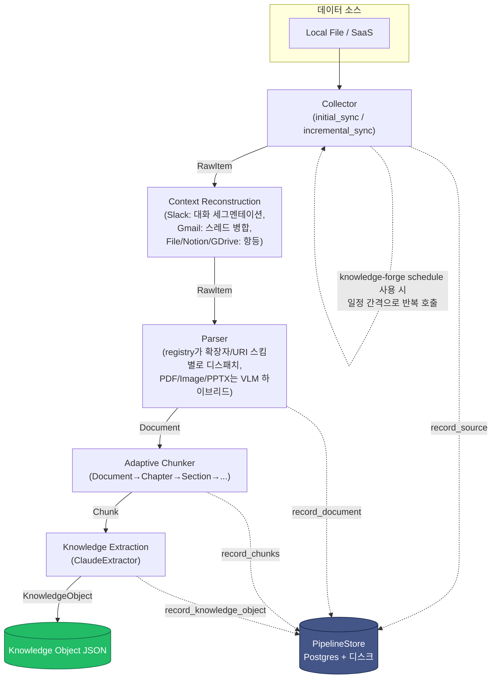

# 아키텍처

Knowledge Forge는 다양한 소스의 원본 데이터를 구조와 의미를 보존한 **Knowledge Object**로
변환하는 파이프라인이다. 각 단계는 독립된 인터페이스(ABC)로 분리되어 있어, 특정 소스나 포맷을
추가할 때 다른 단계를 건드릴 필요가 없다.

## 파이프라인 개요

각 화살표 라벨이 단계 간에 오가는 자료형이다. `RawItem → Document → Chunk → KnowledgeObject`
순으로 갈수록 더 구조화되고, 동시에 원본으로 되돌아갈 수 있는 참조(provenance)를 계속 유지한다.

점선은 옵션 경로다: `PipelineStore`(저장, [`storage.md`](storage.md) 참고)는 `--store`/
`KF_DATABASE_URL`이 설정된 경우에만 각 단계 산출물을 Postgres+디스크에 기록하며, 없어도 파이프라인은
동일하게 동작한다(출력만 생성). `knowledge-forge schedule`([`scheduling.md`](scheduling.md) 참고)은
`extract`와 동일한 파이프라인을 한 프로세스 안에서 반복 실행하는 대안적 진입점이다.

## 컴포넌트별 책임

### Collector (`src/knowledge_forge/collectors/`)

- 원본 데이터를 있는 그대로 가져와 `RawItem`(uri, content, content_hash, modified_at, metadata,
  deleted)으로 통일한다.
- `Collector` ABC는 `initial_sync()` / `incremental_sync(cursor)` / `get_cursor()` 세 메서드로
  구성되며, 파일시스템 순회(File)와 페이지네이션 API 폴링(SaaS)을 동일한 형태로 다룰 수 있게
  설계했다. 변경 감지는 `content_hash`, 삭제 감지는 `RawItem.deleted=True`로 통일적으로 표현한다.
- `LocalFileCollector`는 실제로 동작하며, JSON 매니페스트(경로→해시/mtime)를 저장해 증분
  동기화 시 변경/신규/삭제를 구분한다. `uri`는 항상 `file://{절대경로}` 형태로 원본 위치를
  보존한다.
- Slack/Gmail/GoogleDrive/Notion 커넥터는 실제 SDK 연동으로 동작한다 — 다만 CLI에서 실행할 방법은
  아직 없다. 자세한 내용은 [`saas-connectors.md`](saas-connectors.md)와 [`roadmap.md`](roadmap.md)
  참고.

### Context Reconstruction (`src/knowledge_forge/context/`)

- Collector가 만든 `RawItem` 하나가 항상 독립된 의미 단위인 건 아니다 — 파일은 맞지만, Slack
  메시지 하나나 Gmail 이메일 하나는 그 자체로 의미가 불완전할 수 있다. `ContextReconstructor` ABC의
  `reconstruct(items) -> Iterator[RawItem]`가 Collector와 Parser 사이에서 원본 아이템 스트림을
  재구성해 semantic unit으로 병합한다.
- `default_reconstructor_for(source_type)`가 소스별 기본 구현을 고른다: File/Notion/Google
  Drive는 `NoopReconstructor`(항등, 변경 없음), Slack은 `SlackConversationReconstructor`(스레드
  그룹핑 + 시간 간격 기반 Conversation Segmentation), Gmail은 `GmailThreadReconstructor`
  (`threadId` 기준 병합)다. `pipeline.run_pipeline`이 별도 인자를 안 주면 이 기본값을 쓴다.
- 병합된 `RawItem`은 URI에 파일 확장자가 없으므로(`slack://...`, `gmail://thread/...`),
  `ParserRegistry`가 확장자뿐 아니라 URI 스킴으로도 디스패치할 수 있게 확장되어 있고, 새
  `ConversationParser`(`parsers/conversation.py`)가 두 스킴을 모두 처리한다.
- 자세한 설계와 예시는 [`context-reconstruction.md`](context-reconstruction.md) 참고.

### Parser (`src/knowledge_forge/parsers/`)

- `Parser` ABC의 `parse(item, source_ref) -> Document` 하나로 모든 포맷을 공통 `Document` 구조로
  변환한다. `ParserRegistry`가 파일 확장자(또는 Context Reconstruction이 만든 아이템의 URI
  스킴)를 보고 알맞은 Parser를 찾아 디스패치한다.
- `Document.elements`는 `Heading` / `TextBlock` / `TableElement` / `ListElement` / `ImageElement`의
  판별 유니온(discriminated union)이며, 각 요소는 `element_id`, `page`(가능한 경우), `bbox`(페이지 내
  위치, 현재는 PDF만)를 갖는다. `TableElement`/`ImageElement`는 추가로 `extraction_method`
  (`"rule_based"` | `"vlm"` | `None`)를 가져 어느 경로로 만들어졌는지 추적할 수 있다.
- PDF/DOCX/Markdown/TXT/XLSX/PPTX/Image는 실제 동작하고, HWPX만 스텁으로 남아있다.
- **PDF/Image/PPTX는 순수 규칙 기반이 아니라 VLM 하이브리드다**: 일반 텍스트는 여전히
  결정론적으로 추출하지만, 표/이미지/차트/다이어그램은 항상 Claude vision(`VisionExtractor`)으로
  보낸다. 설계 근거와 상세 동작은 [`vision-extraction.md`](vision-extraction.md) 참고.
- 포맷별 라이브러리와 라이선스 근거는 [`parsers.md`](parsers.md) 참고.

### Adaptive Chunker (`src/knowledge_forge/chunking/`)

- `Chunker` ABC의 `chunk(document) -> list[Chunk]`. `Document.elements`를 Chapter/Section/Paragraph
  트리로 구성한 뒤, 토큰 예산을 넘을 때만 더 작은 단위(Sentence/Line)로 내려간다.
- 자세한 알고리즘과 설계 원칙은 [`adaptive-chunking.md`](adaptive-chunking.md) 참고.

### Knowledge Extraction (`src/knowledge_forge/extraction/`)

- `Extractor` ABC의 `extract(chunk, document, source) -> KnowledgeObject`. `ClaudeExtractor`가
  Claude LLM을 호출해 Entity/Relation/Summary/Key Facts/Topic/Document Type을 추출한다.
- 스키마와 프롬프트 설계는 [`knowledge-object-schema.md`](knowledge-object-schema.md) 참고.
- `extraction/auth.py`가 Anthropic 자격 증명(`ANTHROPIC_API_KEY` 또는 `ant auth login` OAuth
  프로필)이 존재하는지 CLI 시작 시점에 미리 점검한다 — Knowledge Extraction과 Vision 추출
  (아래) 둘 다 이 자격 증명을 공유한다.

### Storage (`src/knowledge_forge/storage/`) — 선택적

- `PipelineStore`가 파이프라인의 각 단계 산출물을 저장하는 파사드다: 원본 바이트는 디스크에
  (`RawBlobStore`), `Source`/`Document`/`Chunk`/`KnowledgeObject`는 PostgreSQL에
  (`PostgresStore`). `pipeline.run_pipeline(..., store=...)`가 `None`이면(기본값) Phase 1과
  동일하게 저장 없이 동작한다.
- 상세 스키마와 사용법은 [`storage.md`](storage.md) 참고.

### Scheduling (`src/knowledge_forge/scheduling/`) — 선택적

- `knowledge-forge extract`는 1회성 실행이고, `knowledge-forge schedule`은 동일한 파이프라인을
  `APScheduler`로 일정 간격마다 반복 실행하는 장기 실행 프로세스다. 상세 동작은
  [`scheduling.md`](scheduling.md) 참고.

## 확장 포인트

새로운 SaaS 커넥터를 추가하려면:
1. `collectors/saas/`에 `SaaSCollector`를 상속한 새 클래스를 만들고 `initial_sync`/
   `incremental_sync`/`get_cursor`를 구현한다.
2. 다른 어떤 단계도 수정할 필요가 없다 — Parser/Chunker/Extraction은 `RawItem`/`Document`라는
   공통 계약에만 의존한다.

새로운 파일 포맷을 추가하려면:
1. `parsers/`에 `Parser`를 상속한 클래스를 만들고 `supported_extensions`와 `parse()`를 구현한다.
2. `parsers/registry.py`의 `default_registry()`에 등록한다.
3. Collector/Chunker/Extraction은 그대로 재사용된다.

이 ABC + 레지스트리 패턴 덕분에 PRD가 요구하는 4개 SaaS + 8개 파일 포맷 전체를, 이번 MVP처럼
일부만 실제 구현하고 나머지는 인터페이스만 정의해 두는 점진적 확장이 자연스럽게 가능하다.

## 설계 결정: Provenance는 참조(ref)로, 전체 객체 임베드 아님

`KnowledgeObject.source`/`document`/`chunk`는 `Source`/`Document`/`Chunk` 전체를 담지 않고
`SourceRef`/`DocumentRef`/`ChunkRef`라는 가벼운 참조(id + 식별에 필요한 최소 필드)만 담는다.

**이유**: 한 `Document`는 보통 여러 `Chunk`로 쪼개지고, 각 `Chunk`는 각자의 `KnowledgeObject`를
만든다. 만약 매 `KnowledgeObject`가 원본 `Document` 전체(모든 elements 포함)를 껴안고 있다면,
문서 하나가 100개 청크로 쪼개졌을 때 동일한 문서 데이터가 100번 중복 저장된다. 참조 방식을
쓰면 `Source`/`Document`/`Chunk` 레코드는 파이프라인 실행 결과물 안에서 id로 한 번만 저장되고,
`KnowledgeObject`는 그 id 체인(`source_id → document_id → chunk_id → knowledge_object_id`)만
유지하면 된다. PRD가 요구하는 "모든 Knowledge Object는 Provenance를 유지한다"는 조건은 이
id 체인으로 충분히 만족된다.
