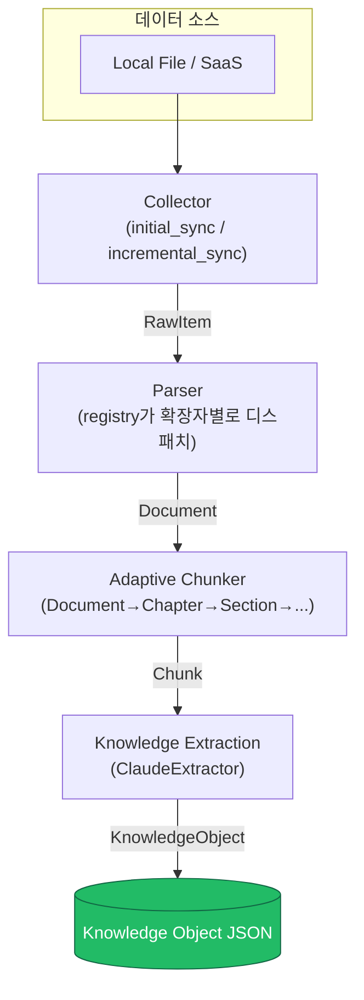

# 아키텍처

Knowledge Forge는 다양한 소스의 원본 데이터를 구조와 의미를 보존한 **Knowledge Object**로
변환하는 파이프라인이다. 각 단계는 독립된 인터페이스(ABC)로 분리되어 있어, 특정 소스나 포맷을
추가할 때 다른 단계를 건드릴 필요가 없다.

## 파이프라인 개요

각 화살표 라벨이 단계 간에 오가는 자료형이다. `RawItem → Document → Chunk → KnowledgeObject`
순으로 갈수록 더 구조화되고, 동시에 원본으로 되돌아갈 수 있는 참조(provenance)를 계속 유지한다.

## 컴포넌트별 책임

### Collector (`src/knowledge_forge/collectors/`)

- 원본 데이터를 있는 그대로 가져와 `RawItem`(uri, content, content_hash, modified_at, metadata,
  deleted)으로 통일한다.
- `Collector` ABC는 `initial_sync()` / `incremental_sync(cursor)` / `get_cursor()` 세 메서드로
  구성되며, 파일시스템 순회(File)와 페이지네이션 API 폴링(SaaS)을 동일한 형태로 다룰 수 있게
  설계했다. 변경 감지는 `content_hash`, 삭제 감지는 `RawItem.deleted=True`로 통일적으로 표현한다.
- `LocalFileCollector`는 실제로 동작하며, JSON 매니페스트(경로→해시/mtime)를 저장해 증분
  동기화 시 변경/신규/삭제를 구분한다. `uri`는 항상 `file://{절대경로}` 형태로 원본 위치를
  보존한다.
- Slack/Gmail/GoogleDrive/Notion 커넥터는 이번 MVP에서 인터페이스만 정의한다(실제 SDK 클라이언트를
  주입받는 생성자 시그니처는 확정, 동기화 메서드는 `NotImplementedError`). 자세한 구현 계획은
  각 클래스의 docstring과 [`roadmap.md`](roadmap.md) 참고.

### Parser (`src/knowledge_forge/parsers/`)

- `Parser` ABC의 `parse(item, source_ref) -> Document` 하나로 모든 포맷을 공통 `Document` 구조로
  변환한다. `ParserRegistry`가 파일 확장자를 보고 알맞은 Parser를 찾아 디스패치한다.
- `Document.elements`는 `Heading` / `TextBlock` / `TableElement` / `ListElement` / `ImageElement`의
  판별 유니온(discriminated union)이며, 각 요소는 `element_id`와 `page`(가능한 경우)를 갖는다.
- PDF/DOCX/Markdown/TXT는 실제 동작하고, XLSX/PPTX/Image/HWPX는 스텁이다. 포맷별 라이브러리와
  라이선스 근거는 [`parsers.md`](parsers.md) 참고.

### Adaptive Chunker (`src/knowledge_forge/chunking/`)

- `Chunker` ABC의 `chunk(document) -> list[Chunk]`. `Document.elements`를 Chapter/Section/Paragraph
  트리로 구성한 뒤, 토큰 예산을 넘을 때만 더 작은 단위(Sentence/Line)로 내려간다.
- 자세한 알고리즘과 설계 원칙은 [`adaptive-chunking.md`](adaptive-chunking.md) 참고.

### Knowledge Extraction (`src/knowledge_forge/extraction/`)

- `Extractor` ABC의 `extract(chunk, document, source) -> KnowledgeObject`. `ClaudeExtractor`가
  Claude LLM을 호출해 Entity/Relation/Summary/Key Facts/Topic/Document Type을 추출한다.
- 스키마와 프롬프트 설계는 [`knowledge-object-schema.md`](knowledge-object-schema.md) 참고.

## 확장 포인트

새로운 SaaS 커넥터를 추가하려면:
1. `collectors/saas/`에 `SaaSCollector`를 상속한 새 클래스를 만들고 `initial_sync`/
   `incremental_sync`/`get_cursor`를 구현한다.
2. 다른 어떤 단계도 수정할 필요가 없다 — Parser/Chunker/Extraction은 `RawItem`/`Document`라는
   공통 계약에만 의존한다.

새로운 파일 포맷을 추가하려면:
1. `parsers/`에 `Parser`를 상속한 클래스를 만들고 `supported_extensions`와 `parse()`를 구현한다.
2. `parsers/registry.py`의 `default_registry()`에 등록한다.
3. Collector/Chunker/Extraction은 그대로 재사용된다.

이 ABC + 레지스트리 패턴 덕분에 PRD가 요구하는 4개 SaaS + 8개 파일 포맷 전체를, 이번 MVP처럼
일부만 실제 구현하고 나머지는 인터페이스만 정의해 두는 점진적 확장이 자연스럽게 가능하다.

## 설계 결정: Provenance는 참조(ref)로, 전체 객체 임베드 아님

`KnowledgeObject.source`/`document`/`chunk`는 `Source`/`Document`/`Chunk` 전체를 담지 않고
`SourceRef`/`DocumentRef`/`ChunkRef`라는 가벼운 참조(id + 식별에 필요한 최소 필드)만 담는다.

**이유**: 한 `Document`는 보통 여러 `Chunk`로 쪼개지고, 각 `Chunk`는 각자의 `KnowledgeObject`를
만든다. 만약 매 `KnowledgeObject`가 원본 `Document` 전체(모든 elements 포함)를 껴안고 있다면,
문서 하나가 100개 청크로 쪼개졌을 때 동일한 문서 데이터가 100번 중복 저장된다. 참조 방식을
쓰면 `Source`/`Document`/`Chunk` 레코드는 파이프라인 실행 결과물 안에서 id로 한 번만 저장되고,
`KnowledgeObject`는 그 id 체인(`source_id → document_id → chunk_id → knowledge_object_id`)만
유지하면 된다. PRD가 요구하는 "모든 Knowledge Object는 Provenance를 유지한다"는 조건은 이
id 체인으로 충분히 만족된다.
